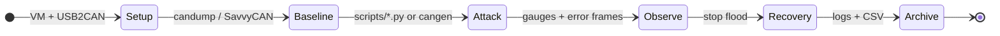

# CAN Analysis and TARA

**Language:** English | [Português (Brasil)](README.pt-BR.md)

Capstone project (IA 495, Fall 2024) — **Eastern Michigan University**

**Instructor:** Samir Tout  
**Team (Group 4):** Julio Ribeiro Barros, Zac Darwiche, David McShane, Richard Cummins

## Overview

This repository supports a controlled-lab study of **Controller Area Network (CAN)** security:

- **Threat Analysis and Risk Assessment (TARA)** focused on **Denial of Service (DoS)** via message flooding
- Simulation of attacks against a **test bench** dashboard (speedometer / gauges), not a road vehicle
- Monitoring with **[linux-can/can-utils](https://github.com/linux-can/can-utils)** (SocketCAN), **Wireshark**, **SavvyCAN**, and Python (`python-can`)

### Upstream foundation

Lab tooling follows the same workflow as the final report: clone or install **[can-utils](https://github.com/linux-can/can-utils)** (`candump`, `cangen`, …), bring up `can0` at 500 kbit/s, then run our Python scripts for targeted dashboard tests. Details: [`docs/can-utils-upstream.md`](docs/can-utils-upstream.md).

> **Safety:** Run only on isolated bench hardware. Do not connect attack tooling to a moving vehicle or public roads.

**Live demo UI:** [jkbarros.github.io/can-analysis-tara-emu](https://jkbarros.github.io/can-analysis-tara-emu/) · GIF previews below; full videos via MP4 or LFS clone.

## Hardware (lab)

- **Test bench cluster:** **2016 GMC Sierra** instrument cluster (see [`docs/test-bench-hardware.md`](docs/test-bench-hardware.md))
- Linux VM (Ubuntu or Kali) as attack / tooling host
- USB2CAN adapter (e.g. CANUSB)
- CAN sniffer and bench wiring (not a complete in-vehicle network)
- Bitrate used in experiments: **500000** (`can0`)

## Software setup (Linux VM)

One-shot (on Ubuntu/Kali VM):

```bash
chmod +x scripts/setup-lab-env.sh
./scripts/setup-lab-env.sh
```

To also clone upstream sources into `third_party/can-utils` (as in the report):

```bash
CLONE_CAN_UTILS=1 ./scripts/setup-lab-env.sh
```

Manual steps:

```bash
sudo apt update
sudo apt install git can-utils
sudo git clone https://github.com/linux-can/can-utils.git   # optional; apt often enough
sudo modprobe can
sudo ip link set can0 up type can bitrate 500000
```

Verify traffic:

```bash
candump -e can0          # terminal 1
cangen can0              # terminal 2
```

Log to file: `candump -l can0`

### Python scripts

All `.py` files are in the **[`scripts/`](scripts/)** folder ([index](docs/scripts.md)).

```bash
python3 -m venv .venv
source .venv/bin/activate
pip install -r requirements.txt
sudo python3 scripts/speed.py              # multi-ID speed simulation
sudo python3 scripts/speed2.py             # fixed payloads on selected IDs
sudo python3 scripts/rpm_attack.py         # random RPM flood on 0xC9 (tachometer)
sudo python3 scripts/blink_interference.py # indicator-lamp flood (0x1F8, 0x1C9, 0x415)
```

SocketCAN usually requires elevated privileges to bring interfaces up/down; scripts call `ip link set` on shutdown.

### SavvyCAN (optional GUI)

See [SavvyCAN AppImage](https://appimage.github.io/SavvyCAN/). Connection type: **QT SerialBus** (PeakCAN / SocketCAN), port `can0`.

## Lab workflow (state machine)



Interactive version: **[`web/index.html`](web/index.html)** (state steps + sample log replay). Host with [GitHub Pages](web/README.md) or `python -m http.server` from the repo root.

## Demo videos

Clone with **`git lfs pull`** so the files below play (Git LFS). More detail: [`docs/demos.md`](docs/demos.md).

| Preview (GIF) | Full video |
|---------------|------------|
|  | MP4 below |
|  | MP4 below |

### Cluster — CAN injection (bench)

<video controls width="100%" src="docs/demo-cluster-can-injection.mp4"></video>

[Open file](docs/demo-cluster-can-injection.mp4) · 2016 GMC Sierra cluster under injected traffic

### RPM flood (`0xC9`)

<video controls width="100%" src="docs/demo-rpm-attack-2024-11-15.mp4"></video>

[Open file](docs/demo-rpm-attack-2024-11-15.mp4) · pairs with [`data/logs/rpm_attack_log.txt`](data/logs/rpm_attack_log.txt)

### Python / VM setup

<video controls width="100%" src="docs/demo-python-can-programming.mp4"></video>

[Open file](docs/demo-python-can-programming.mp4)

> GIFs in [`docs/assets/`](docs/assets/) are short loops for the README; full quality is in the MP4 files.

## Log recording

| Source | Output | In this repo |
|--------|--------|----------------|
| `candump -l can0` | SocketCAN log | [`data/captures/candump-2024-11-11_195750.log`](data/captures/candump-2024-11-11_195750.log) |
| SavvyCAN export | CSV / traces | [`data/captures/speed-test-savvycan.csv`](data/captures/speed-test-savvycan.csv) |
| `rpm_attack.py` | Timestamped lines | [`data/logs/rpm_attack_log.txt`](data/logs/rpm_attack_log.txt) |

Discord exports (docs, captures, scripts) are indexed in [`docs/discord-archive.md`](docs/discord-archive.md).

## Repository layout

| Path | Description |
|------|-------------|
| `scripts/` | `speed.py`, `speed2.py`, `rpm_attack.py`, `blink_interference.py`, `setup-lab-env.sh` |
| `data/captures/` | `candump` and SavvyCAN CSV/exports from the bench |
| `data/logs/` | RPM attack log (2024-11-15) |
| `deliverables/` | Fact-finding Q&A (redacted `.md`), PoC report, Gantt chart |
| `docs/discord-archive.md` | Index of recovered Discord files |
| `docs/can-utils-upstream.md` | Attribution and install for [linux-can/can-utils](https://github.com/linux-can/can-utils) |
| `docs/can-message-notes.md` | CAN IDs captured on the test bench |
| `web/` | Static lab monitor UI (state machine, log replay, videos) |
| `docs/demo-*.mp4` | Bench and development recordings (Git LFS) |
| `IA 495 Final Report.docx` | Submitted capstone report |

## Results (summary)

- Speedometer gauge showed lag and erratic movement under sustained injection
- CAN saturation increased error frames and disrupted normal ECU traffic on the bench
- Highlights need for mitigations (rate limiting, authentication, anomaly detection)

## References

- **SocketCAN tools:** [linux-can/can-utils](https://github.com/linux-can/can-utils)
- Final report bibliography (CANAttack, protocol-compliant DoS on CAN, MDPI CAN security survey, CSS Electronics CAN intro)

## License and safety

- **[LICENSE](LICENSE)** — MIT (Group 4, Fall 2024)
- **[SECURITY.md](SECURITY.md)** — lab-only use; do not use on road vehicles
- **[CHANGELOG.md](CHANGELOG.md)** — repository history
- **[docs/PUBLIC_RELEASE.md](docs/PUBLIC_RELEASE.md)** — checklist before making the repo public

Academic / educational use. Contact authors for other uses.
