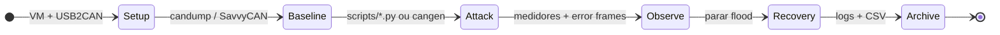
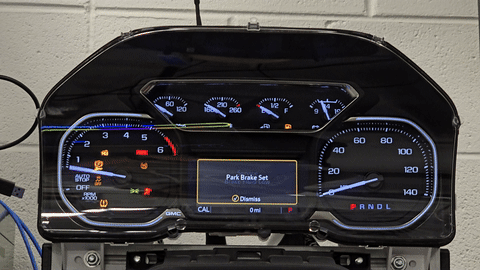
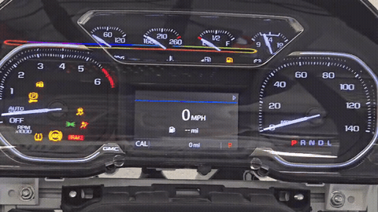

# Análise CAN e TARA

**Idioma:** [English](README.md) | Português (Brasil)

Projeto de conclusão (IA 495, outono de 2024) — **Eastern Michigan University**

**Professor:** Samir Tout  
**Equipe (Grupo 4):** Julio Ribeiro Barros, Zac Darwiche, David McShane, Richard Cummins

## Visão geral

Este repositório documenta um estudo em laboratório controlado sobre segurança em **Controller Area Network (CAN)**:

- **Threat Analysis and Risk Assessment (TARA)** com foco em **Denial of Service (DoS)** por saturação de mensagens
- Simulação de ataques contra o painel de instrumentos em **bancada de teste** (velocímetro / medidores), não em veículo em circulação
- Monitoramento com **[linux-can/can-utils](https://github.com/linux-can/can-utils)** (SocketCAN), **Wireshark**, **SavvyCAN** e Python (`python-can`)

### Base upstream

O ambiente de laboratório segue o relatório final: instalar ou clonar **[can-utils](https://github.com/linux-can/can-utils)** (`candump`, `cangen`, …), subir `can0` a **500 kbit/s** e executar os scripts Python para testes no painel. Detalhes em [`docs/can-utils-upstream.md`](docs/can-utils-upstream.md).

> **Segurança:** use apenas em hardware isolado na bancada. Não conecte ferramentas de ataque a um veículo em movimento ou em via pública.

**Demo web:** [jkbarros.github.io/can-analysis-tara-emu](https://jkbarros.github.io/can-analysis-tara-emu/) · GIFs abaixo; vídeos completos em MP4 ou clone com LFS.

## Hardware (laboratório)

- **Cluster na bancada:** painel de instrumentos **GMC Sierra 2016** (veja [`docs/test-bench-hardware.md`](docs/test-bench-hardware.md))
- VM Linux (Ubuntu ou Kali) como host de ataque / ferramentas
- Adaptador USB2CAN (ex.: CANUSB)
- Sniffer CAN e cabeamento da bancada (não é a rede completa do veículo)
- Taxa usada nos experimentos: **500000** (`can0`)

## Configuração de software (VM Linux)

Instalação rápida (Ubuntu/Kali):

```bash
chmod +x scripts/setup-lab-env.sh
./scripts/setup-lab-env.sh
```

Para clonar também o código upstream em `third_party/can-utils` (como no relatório):

```bash
CLONE_CAN_UTILS=1 ./scripts/setup-lab-env.sh
```

Passos manuais:

```bash
sudo apt update
sudo apt install git can-utils
sudo git clone https://github.com/linux-can/can-utils.git   # opcional; o apt costuma bastar
sudo modprobe can
sudo ip link set can0 up type can bitrate 500000
```

Verificar tráfego:

```bash
candump -e can0          # terminal 1
cangen can0              # terminal 2
```

Gravar log: `candump -l can0`

### Scripts Python

Os arquivos `.py` estão na pasta **[`scripts/`](scripts/)** ([índice](docs/scripts.pt-BR.md)).

```bash
python3 -m venv .venv
source .venv/bin/activate
pip install -r requirements.txt
sudo python3 scripts/speed.py              # simulação de velocidade em vários IDs
sudo python3 scripts/speed2.py             # payloads fixos em IDs selecionados
sudo python3 scripts/rpm_attack.py         # flood de RPM aleatório no 0xC9 (tacômetro)
sudo python3 scripts/blink_interference.py # flood nos indicadores (0x1F8, 0x1C9, 0x415)
```

O SocketCAN em geral exige privilégios elevados; os scripts podem derrubar a interface com `ip link` ao finalizar.

### SavvyCAN (GUI opcional)

[AppImage do SavvyCAN](https://appimage.github.io/SavvyCAN/). Tipo de conexão: **QT SerialBus** (PeakCAN / SocketCAN), porta `can0`.

## Fluxo do laboratório (máquina de estados)



Versão interativa: **[`web/index.html`](web/index.html)** (passos + replay de log de exemplo). Veja [GitHub Pages](web/README.md) ou `python -m http.server` na raiz do repo.

## Vídeos de demonstração

Use **`git lfs pull`** após o clone. Detalhes em [`docs/demos.md`](docs/demos.md).

| Preview (GIF) | Vídeo completo |
|---------------|----------------|
|  | MP4 abaixo |
|  | MP4 abaixo |

### Cluster — injeção CAN (bancada)

<video controls width="100%" src="docs/demo-cluster-can-injection.mp4"></video>

[Abrir arquivo](docs/demo-cluster-can-injection.mp4) · cluster Sierra 2016 sob tráfego injetado

### Ataque de RPM (`0xC9`)

<video controls width="100%" src="docs/demo-rpm-attack-2024-11-15.mp4"></video>

[Abrir arquivo](docs/demo-rpm-attack-2024-11-15.mp4) · ver também [`data/logs/rpm_attack_log.txt`](data/logs/rpm_attack_log.txt)

### Python / setup da VM

<video controls width="100%" src="docs/demo-python-can-programming.mp4"></video>

[Abrir arquivo](docs/demo-python-can-programming.mp4)

> Os GIFs em [`docs/assets/`](docs/assets/) são loops curtos; qualidade total nos MP4.

## Gravação de logs

| Origem | Saída | Neste repositório |
|--------|--------|-------------------|
| `candump -l can0` | Log SocketCAN | [`data/captures/candump-2024-11-11_195750.log`](data/captures/candump-2024-11-11_195750.log) |
| Export SavvyCAN | CSV / traces | [`data/captures/speed-test-savvycan.csv`](data/captures/speed-test-savvycan.csv) |
| `rpm_attack.py` | Linhas com timestamp | [`data/logs/rpm_attack_log.txt`](data/logs/rpm_attack_log.txt) |

Arquivos recuperados do Discord estão indexados em [`docs/discord-archive.md`](docs/discord-archive.md).

## Estrutura do repositório

| Caminho | Descrição |
|---------|-----------|
| `scripts/` | `speed.py`, `speed2.py`, `rpm_attack.py`, `blink_interference.py`, `setup-lab-env.sh` |
| `data/captures/` | Logs `candump` e exportações SavvyCAN da bancada |
| `data/logs/` | Log do ataque de RPM (15/11/2024) |
| `deliverables/` | Q&A com o cliente (`.md` redigido), relatório PoC, cronograma Gantt |
| `docs/discord-archive.md` | Índice dos arquivos do Discord |
| `docs/can-utils-upstream.md` | Créditos e instalação do [linux-can/can-utils](https://github.com/linux-can/can-utils) |
| `docs/can-message-notes.md` | IDs CAN observados na bancada |
| `web/` | Interface web estática (máquina de estados, replay de log, vídeos) |
| `docs/demo-*.mp4` | Gravações de laboratório (Git LFS) |
| `IA 495 Final Report.docx` | Relatório final entregue |

## Resultados (resumo)

- Velocímetro com atraso e comportamento errático sob injeção contínua
- Saturação do CAN com aumento de error frames e interferência no tráfego normal da bancada
- Reforça a necessidade de mitigações (rate limiting, autenticação, detecção de anomalias)

## Referências

- **Ferramentas SocketCAN:** [linux-can/can-utils](https://github.com/linux-can/can-utils)
- Bibliografia do relatório final (CANAttack, DoS em CAN, survey MDPI, intro CSS Electronics)

## Licença e uso responsável

- **[LICENSE](LICENSE)** — MIT (Grupo 4, outono de 2024)
- **[SECURITY.md](SECURITY.md)** — uso apenas em laboratório; não use em veículos em circulação
- **[CHANGELOG.md](CHANGELOG.md)** — histórico do repositório
- **[docs/PUBLIC_RELEASE.md](docs/PUBLIC_RELEASE.md)** — checklist antes de tornar o repo público

Uso acadêmico / educacional. Para outros usos, entre em contato com os autores.
